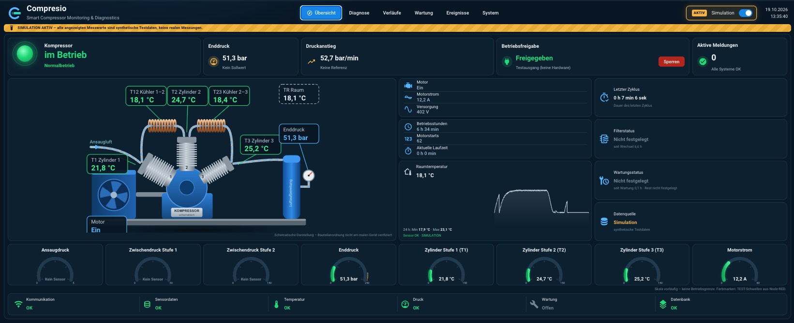
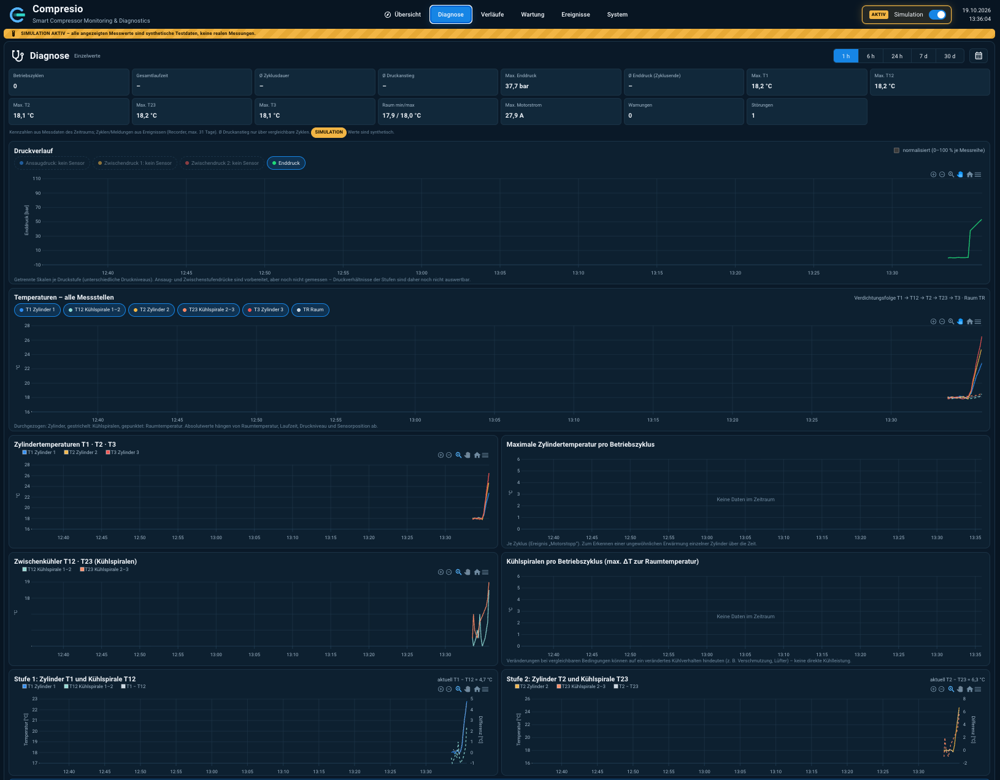
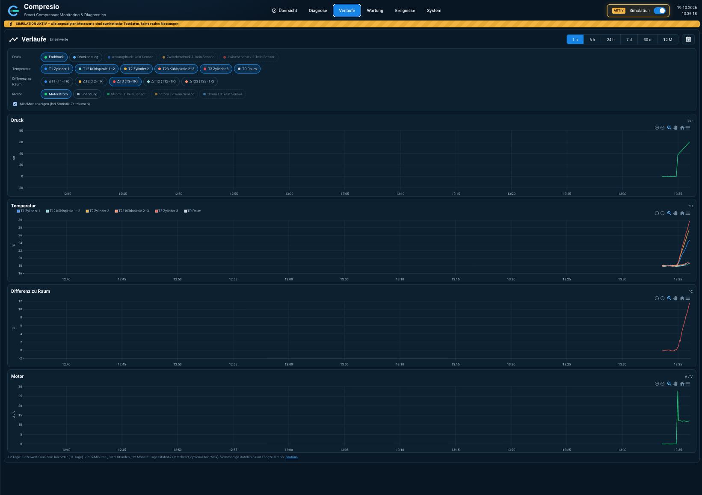
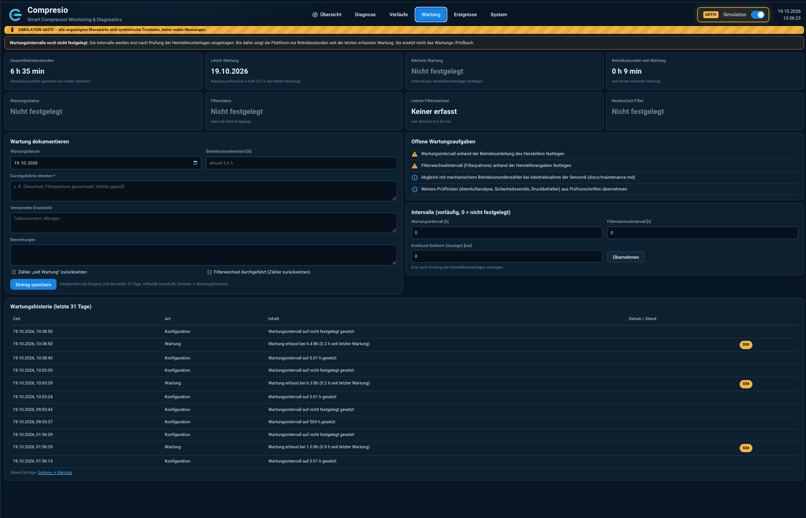
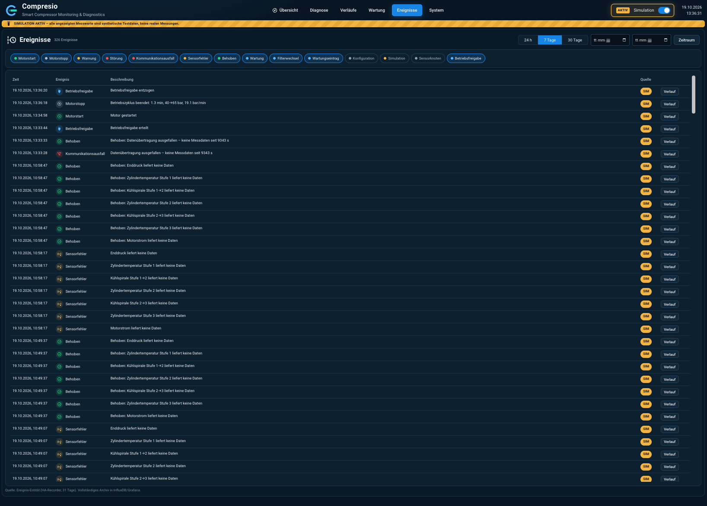
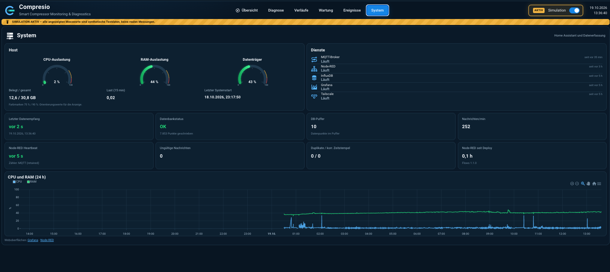

<p align="center">
  <picture>
    <source media="(prefers-color-scheme: dark)" srcset="assets/branding/logo-horizontal-dark.svg">
    
  </picture>
</p>

<p align="center"><strong>Smart Compressor Monitoring &amp; Diagnostics</strong></p>

<p align="center">Softwareplattform zur Überwachung, Digitalisierung und Diagnose von Kompressoranlagen –<br>entstanden für einen Atemluftkompressor im Tauchsport.</p>

<p align="center"><strong>Source Available</strong> · keine Open-Source-Lizenz im Sinne der OSI</p>

<p align="center">
  
</p>

Herstellerunabhängig: nutzbar für jeden mehrstufigen Atemluftkompressor; Name, Entitäten und Darstellungsbereiche sind konfigurierbar (`dashboard/cards/src/config.js`).

> **Free for Noncommercial Use · Commercial License Required**
> **Source Available** – keine Open-Source-Lizenz im Sinne der OSI.

## License & Usage

**Status:** Die Lizenz ist noch nicht endgültig festgelegt. Bis dahin gilt [LICENSE](LICENSE) (alle Rechte vorbehalten). Vorgesehen ist das folgende Modell (Details: [docs/licensing.md](docs/licensing.md)).

### Deutsch
- **Kostenlos für jeden eingetragenen Verein (e.V.)** für seinen eigenen Vereinsbetrieb, auch wenn er Flaschen gegen Entgelt füllt oder einer Tauchschule angegliedert ist.
- **Kostenlos für Privatpersonen** zur privaten Nutzung.
- **Ändern und Weiterentwickeln erlaubt**, ebenso Veröffentlichen und Weitergeben, jeweils unter den Bedingungen der Community-Lizenz.
- **Nicht kostenlos** für nicht eingetragene Vereine. **Nicht zulässig** ist der Betrieb durch oder für eine Tauchschule über einen Verein (verdeckte gewerbliche Nutzung).
- **Kommerzielle Nutzung nur mit separater Lizenz:** gewerbliche Tauchschulen, Tauchshops, Tauchcenter, Kompressorbetreiber, Unternehmen, Systemintegratoren, Hersteller.
- **Auch rein interne gewerbliche Nutzung ist lizenzpflichtig**, z. B. eine Tauchschule, die nur ihren eigenen Kompressor überwacht. Siehe [LICENSE-COMMERCIAL.md](LICENSE-COMMERCIAL.md).
- Fremdkomponenten behalten ihre eigenen Lizenzen: [THIRD_PARTY_LICENSES.md](THIRD_PARTY_LICENSES.md).

### English
- **Free for any registered association under German law ("e.V.")** for its own association activities, including those filling cylinders for a fee or attached to a dive school.
- **Free for individuals** for private use.
- **Modification and further development allowed**, including publishing and redistribution, under the community license terms.
- **Not free** for unregistered associations. Operation by or for a dive school through an association (concealed commercial use) is **not** permitted.
- **Commercial use requires a separate license:** commercial dive schools, dive shops, dive centers, compressor operators, companies, system integrators, manufacturers.
- **Internal commercial use also requires a license**, e.g. a dive school monitoring only its own compressor. See [LICENSE-COMMERCIAL.md](LICENSE-COMMERCIAL.md).
- Third-party components keep their own licenses: [THIRD_PARTY_LICENSES.md](THIRD_PARTY_LICENSES.md).

Rechteinhaber / copyright holder: Björn Makowe (private Entwicklung) · Kontakt / contact: GitHub-Issue „Lizenzanfrage“ / "license request"

> ⚠ **Kein Sicherheitssystem / not a safety system.** Die Software ersetzt keine Sicherheitsventile, Druckschalter, Schutzeinrichtungen oder vorgeschriebenen Prüfungen. Siehe [DISCLAIMER.md](DISCLAIMER.md).

Mitwirken: [CONTRIBUTING.md](CONTRIBUTING.md) · Sicherheitslücken melden: [SECURITY.md](SECURITY.md)

Überwachung, Datenerfassung und Diagnose des Atemluftkompressors mit Home Assistant, MQTT, Node-RED, InfluxDB und Grafana.

**Sicherheitsgrundsatz:** Alle sicherheitsrelevanten Schutzfunktionen des Kompressors arbeiten unabhängig von Home Assistant, Netzwerk und Software. Bestehende Sicherheitseinrichtungen werden nie überbrückt. Diese Plattform ist eine Diagnose- und Informationsebene, keine Sicherheitsebene. Einziger Eingriff ist die optionale Betriebsfreigabe: Sie kann den Betrieb nur sperren oder freigeben (Hilfsschütz in Reihe mit den Schutzkontakten, siehe [docs/steuerung.md](docs/steuerung.md)) und überbrückt keine Schutzfunktion.

## Dashboard
Eigenes Dashboard in Home Assistant mit sechs Ansichten. Die Screenshots zeigen **Simulationsdaten**, keine realen Messwerte. Details: [docs/dashboard.md](docs/dashboard.md).

| Diagnose | Verläufe |
|---|---|
| [](docs/images/dashboard-diagnose.png) | [](docs/images/dashboard-verlaeufe.png) |
| **Wartung** | **Ereignisse** |
| [](docs/images/dashboard-wartung.png) | [](docs/images/dashboard-ereignisse.png) |
| **System** | |
| [](docs/images/dashboard-system.png) | |

## Aufbau
```
Sensorik / SIMULATION → MQTT (Mosquitto) → Node-RED → InfluxDB → Grafana
                                    └──────→ Home Assistant → Compresio-Dashboard, Benachrichtigungen
```
Details: [docs/architecture.md](docs/architecture.md). Stand und Testergebnisse: [docs/roadmap.md](docs/roadmap.md).

## Repository
| Pfad | Inhalt |
|---|---|
| `docs/` | Dokumentation (Ist-Zustand und Planung getrennt), Screenshots in `docs/images/` |
| `config/nodered/flows.json` | Node-RED-Flows (Export ohne Credentials) |
| `config/influxdb/schema.influxql` | Datenbank, Retention Policies, Continuous Queries, Benutzer |
| `config/grafana/` | Datenquelle und Dashboard |
| `config/homeassistant/` | Automationen und Dashboard |
| `dashboard/` | Compresio-Dashboard (in HA: „Kompressorraum“): Quellcode (`cards/src`), Build (`dist`), ApexCharts (MIT, `vendor`), Theme (`styles`), UI-Tests (`test`) |
| `assets/branding/` | Logo, Favicon, Social Preview, Markenrichtlinie ([BRANDING.md](assets/branding/BRANDING.md)) |
| `tools/` | Generatoren/Deployment (`build_nodered.py`, `build_grafana.py`, `build_ha.py`, `setup_influx.py`, `build_branding.mjs`), Tests (`e2e_test.py`, `check_grafana.py`), API-Client `ha.py` |

## Einrichtung / Neu-Deployment
```bash
python3 -m venv .venv && .venv/bin/pip install websockets requests paho-mqtt
.venv/bin/python tools/setup_influx.py      # InfluxDB-Schema
.venv/bin/python tools/build_nodered.py     # Node-RED-Flows (inkl. MQTT-Discovery)
.venv/bin/python tools/build_grafana.py     # Grafana
.venv/bin/python tools/build_ha.py          # HA-Automationen + Standardkarten-Dashboard
.venv/bin/python tools/setup_templates.py   # Template-Sensoren ΔT zur Raumtemperatur
.venv/bin/python tools/build_dashboard.py   # Compresio-Dashboard (Panel) bauen + einspielen
(cd dashboard/test && npm install && npx playwright install chromium && node shoot.mjs && node interact.mjs)
.venv/bin/python tools/e2e_test.py          # End-to-End-Test mit Simulation (~20 min)
```
Voraussetzungen: `.env` (Vorlage: `.env.example`) mit Zugang zu Home Assistant (`HA_URL`, `HA_TOKEN`, siehe [docs/admin-zugang.md](docs/admin-zugang.md)) und den Passwörtern (`MQTT_NODERED_PASSWORD`, `MQTT_SENSOR_PASSWORD`, `INFLUX_NODERED_PASSWORD`, `INFLUX_GRAFANA_PASSWORD`, `HA_BACKUP_PASSWORD`). **Keine Zugangsdaten in diesem Repository.**
